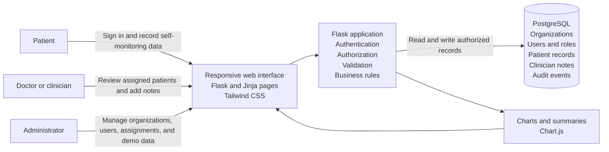
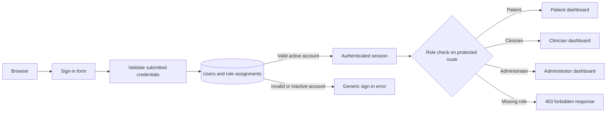
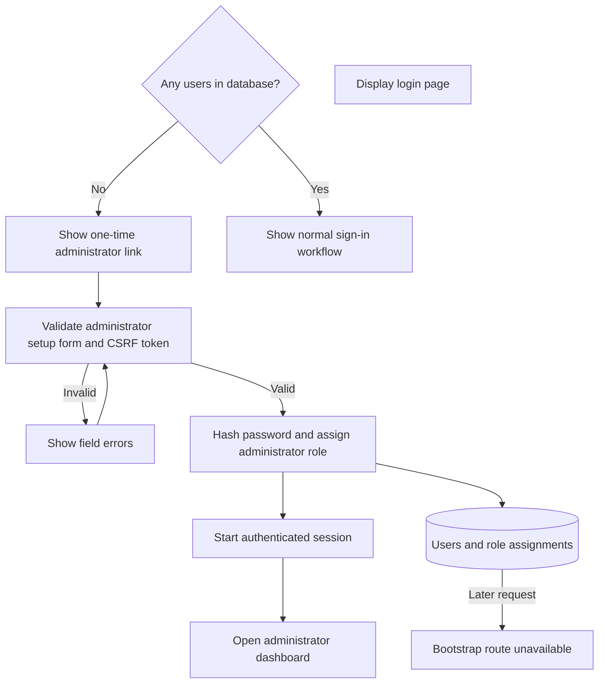
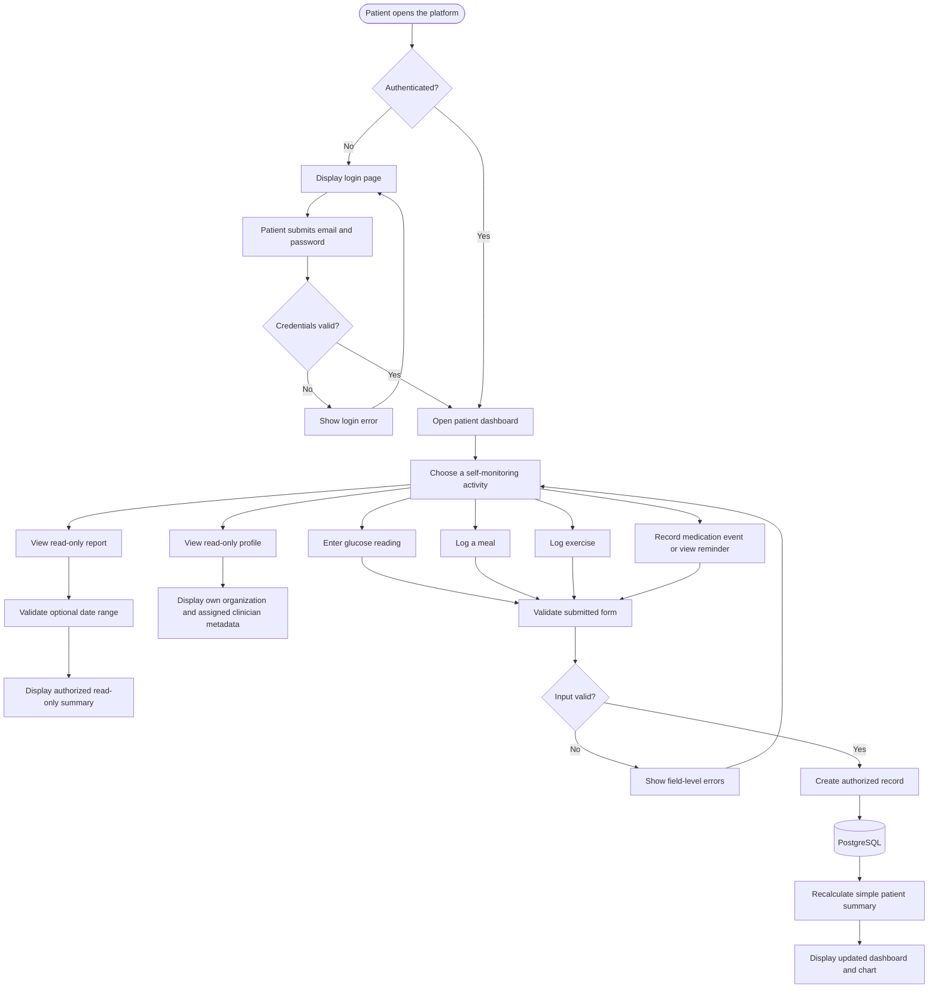
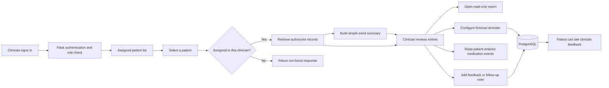
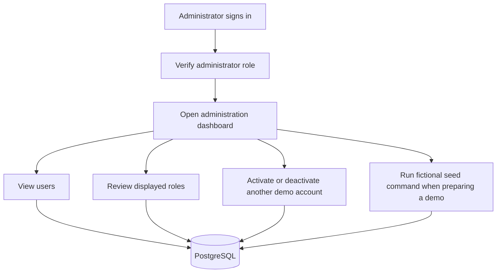
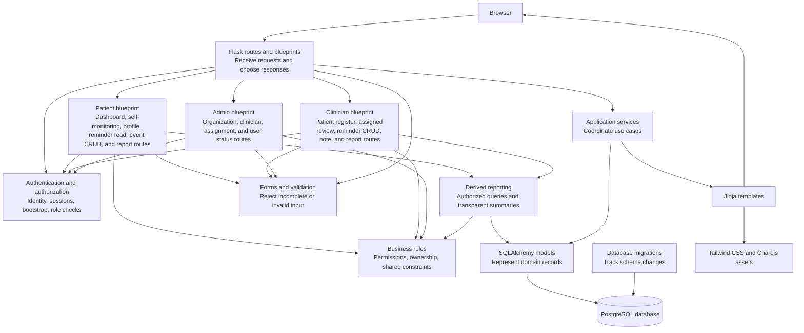
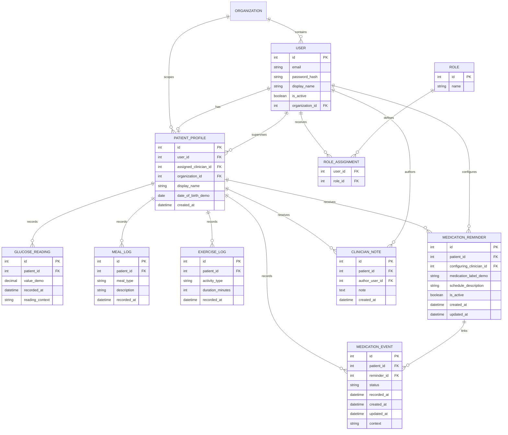

# System Tutorials and Flowcharts

## Purpose

# Use (CTRL + SHIFT + V) to convert to mermaid and view flowcharts.

This document explains how AfyaGlyco works and how planned changes fit the implemented design. It is both a student tutorial and a living design reference.

The diagrams use Mermaid flowchart syntax. They should be readable in Markdown tools that support Mermaid, and they should be kept close to the written explanation so that a reader can follow the system from user action to stored data and back to the user.

The system shown here is theoretical. It is designed for an academic capstone demonstration using fictional or seeded records.

Sprint 01 implements the core records for the first vertical slice: users, roles, patient profiles, clinician assignment, glucose readings, and clinician-authored notes. Meal, exercise, medication, reminder, audit, and report records remain planned work.

Sprint 02 implements session-based authentication, CSRF-protected sign-in and sign-out, fictional demo-account seeding, and server-side role protection for patient, clinician, and administrator areas. The role dashboards are intentionally small placeholders until the related workflows are implemented.

Sprint 06 implements the central business-rules contract and complete patient CRUD for meal and exercise records. Patients can manage only their own records, while assigned clinicians can read those records without mutation controls. The rules module is the authoritative application-level source for permissions and shared constraints.

Sprint 07 implements the safe medication-reminder and medication-event workflow. Assigned clinicians can fully manage fictional reminders for their assigned patients. Patients can view their configured reminders and fully manage their own patient-entered medication events. Assigned clinicians can read those events, but the system does not infer adherence, recommend treatment, or send notifications.

Sprint 08 implements read-only derived reports for patients and assigned clinicians. The reports aggregate already-authorized fictional records, offer an optional validated date range, and show transparent counts and a recorded-value trend. Reports are not stored records and have no create, update, or delete operations.

Sprint 09 implements organization-scoped account provisioning and patient registers. Administrators can manage fictional clinics or hospitals and provision clinician accounts. Clinicians can register fictional patients or attach existing unassigned patients in their organization. Patient assignment metadata is kept separate from health-record access, and administrators still do not receive health-record or report access by default.

Sprint 10 implements one-time first-administrator bootstrap. When the `users` table is empty, the login page shows a CSRF-protected setup link. The route creates one administrator with a hashed password, assigns the administrator role, starts a session, and becomes unavailable after the first user exists. The existing seed command remains available for repeatable fictional demonstration accounts.

## How to read the model

- A user action starts a flow.
- A Flask route receives and validates the request.
- The central business-rules module applies permissions and shared constraints.
- A service or model coordinates the authorized operation.
- PostgreSQL stores or retrieves the record.
- The response returns to the appropriate dashboard.
- A clinician note or simulated reminder is shown as application output, not as an autonomous medical decision.

## 1. System context

The platform has three human roles. All roles use the browser interface, but each role sees only the areas permitted by its authorization. Organizations provide the administrative boundary for clinician membership and patient registration; the application supports one organization per clinician or patient in this demonstration slice.

## 1a. Authentication and role protection

Every role signs in through the same form. Flask-Login creates the session, and each protected route checks the user's active status and role on the server. The interface does not rely on hidden links as authorization.

After authentication, organization and assignment checks are applied where a workflow needs them. An inactive organization blocks new clinician registrations, patient registrations, and assignment changes; it does not automatically expose or alter existing health records.

## 1b. First-administrator bootstrap

The bootstrap flow is a supervised setup path for a fresh demonstration database, not a general public registration feature. The login page queries whether any user exists and renders the setup link only when the answer is no. The GET and POST route repeats the same server-side check, validates the form and CSRF token, hashes the password, creates the administrator role assignment, signs the new account in, and redirects to the administrator dashboard. After the first account exists, the route returns not found and the link is not rendered.

## 2. Patient data-flow tutorial

This is the primary student demonstration flow. It shows how a patient creates a record and later sees it in a dashboard.

The glucose-reading branch is implemented in Sprint 03 and its CRUD completeness is closed in Sprint 06. A signed-in patient opens the responsive patient dashboard, submits a value, timestamp, and optional context, and can then view, edit, or delete the entry through the history and detail pages. Every patient query is filtered by the signed-in user's patient profile; attempting to open or mutate another patient's reading returns a not-found response.

The meal and exercise branches are implemented in Sprint 06. A patient can create, view, edit, and delete their own fictional meal or exercise records. The same ownership check is applied to every read, update, and delete query. An assigned clinician can read the records from the patient review page, but cannot mutate them. The application stores and displays these entries without calculating nutrition, prescribing exercise, or inferring clinical outcomes.

The medication branch is implemented in Sprint 07. An assigned clinician creates a fictional medication label and schedule description for a patient. The patient can read that reminder and can create, view, edit, or delete an event with a controlled status, timestamp, and optional context. The event is only the patient's recorded input; it is not converted into an adherence score or clinical conclusion.

The reporting branch is implemented in Sprint 08. A patient can open a read-only summary of their own records, and an assigned clinician can open the corresponding summary for that patient. Both pages can accept a start and end date, but the report only counts and displays the records that the current role is already permitted to read. Empty periods are presented as empty data, not as a health conclusion.

The registration branch is implemented in Sprint 09. An administrator creates or updates a fictional organization and provisions a clinician account in that organization. The clinician then sees only their own register and may either create a fictional patient registration or attach an existing unassigned patient from the same organization. A clinician cannot take over an existing assignment or cross an organization boundary. A patient can view their own organization and assigned clinician summary, but cannot edit either relationship.

For medication records, the authorized record step is split by ownership: the clinician creates or changes a reminder for an assigned patient, while the patient creates or changes the event associated with that reminder. Both roles see only records permitted by the central business-rules contract.

## 3. Clinician review flow

The clinician does not receive every record as a separate task. The prototype presents patient history, trends, and clinician-authored notes for review.

The assigned-patient review branch is implemented in Sprint 04 and extended in Sprints 07 and 08. The clinician dashboard lists only patient profiles whose `assigned_clinician_id` matches the signed-in clinician. The review page retrieves readings, meal and exercise records, reminders, medication events, and notes only after that assignment check succeeds. The clinician can open a derived report for the same assigned patient; the report is read-only and uses the same assignment boundary. A clinician-authored note is stored and then displayed on the patient's dashboard.

The feedback is authored by the clinician. The system stores and displays it; it does not generate treatment instructions on the clinician's behalf.

## 4. Administrator flow

The administrator controls fictional demonstration-account status and reviews role assignments. This flow is intentionally small so that the capstone can show account management without becoming a complete enterprise administration system. Sprint 05 implements the user list and activation/deactivation of other demo accounts; the administrator cannot deactivate its own account.

For a fresh demonstration database, Sprint 10 adds a one-time first-administrator link to the login page. After that account is created, the administrator uses the existing account-management routes, while the seed command remains the repeatable way to prepare the fictional patient, clinician, and administrator accounts.

## 5. Logical application interconnection

This diagram describes the expected separation of responsibilities in the Flask application. It is not a requirement to create every box as a separate Python package immediately; it is a guide for keeping responsibilities understandable.

## 6. Theoretical records and relationships

The initial data model should remain understandable for a student project.

The field names above are conceptual. They may change during implementation, but the ownership and authorization relationships should remain explicit.

The current implementation uses one optional assigned clinician per patient profile for the first MVP. The patient profile still belongs to its patient user; the clinician relationship is used to limit review access.

The current implementation uses concrete `MealLog` and `ExerciseLog` records. Patients have complete CRUD access to their own glucose, meal, and exercise entries, assigned clinicians have read-only access, and administrators do not receive health-record access by default. These permissions are defined in `app/business_rules.py` and enforced by the routes.

The current implementation also uses concrete `MedicationReminder` and `MedicationEvent` records. Assigned clinicians have complete CRUD access to reminders for their assigned patients. Patients have read-only access to reminders and complete CRUD access to their own events. Assigned clinicians have read-only access to events, and administrators do not receive medication-record access by default.

Sprint 08 adds no report table. `app/reporting.py` derives a read-only summary from the existing records after the route verifies patient ownership or clinician assignment. Patients and assigned clinicians have read access to the derived report; administrators have no health-summary access by default. The report's create, update, and delete operations are intentionally not applicable.

Sprint 09 adds the concrete `Organization` record and organization foreign keys on users and patient profiles. Administrators have complete applicable management operations for organization metadata except hard delete, and can provision or deactivate clinician accounts. Clinicians can create and read their own patient register, register a new patient, or attach an existing unassigned patient in the same active organization. Administrators can transfer or unassign assignment metadata without reading health records. Patient profile metadata is read-only from the patient interface. These boundaries are enforced in route handlers and the centralized rules module.

## 7. Student demonstration tutorial

### Prepare the demonstration

1. Start the Flask application.
2. Connect the application to a local PostgreSQL database.
3. Run database migrations.
4. If the database is empty, open the login page and create the first administrator through the one-time bootstrap link. For a repeatable full demo dataset, run `flask --app run:app seed-demo --password "choose-a-local-demo-password"` instead.
5. Open the application in a browser.

### Demonstrate organization and registration management

1. Sign in with the administrator account.
2. Open Organizations and create or edit a fictional clinic or hospital; demonstrate activation or deactivation rather than deletion.
3. Open Clinicians and provision a clinician account in the active organization; confirm that the password is never displayed after submission.
4. Open Patients to review assignment metadata only, then demonstrate transfer or unassignment without opening a health record.
5. Sign out and sign in with the newly provisioned clinician account.
6. Open the patient register and register a new fictional patient, or attach an existing unassigned patient from the same organization.
7. Confirm that the register contains only the clinician's assigned patients and that an assigned or cross-organization patient cannot be attached.
8. Sign in as the patient and open Profile to show the read-only organization and assigned-clinician summary.

### Demonstrate the patient role

1. Sign in with the seeded patient account.
2. Open the patient dashboard.
3. Add one or more fictional glucose readings.
4. Add a fictional meal and exercise entry.
5. Return to the dashboard.
6. Show the new entries and updated recorded-value summary.
7. Open a meal or exercise entry, demonstrate edit, then demonstrate delete.
8. Sign out after confirming the reading, meal, and exercise histories.
9. Open the patient report, show the all-records summary, then apply a valid date range and show the filtered empty or populated state.

### Demonstrate the clinician role

1. Sign out and sign in with the seeded clinician account.
2. Open the assigned patient list.
3. Select the demonstration patient.
4. Review the patient's entries and trend summary.
5. Add a clearly labelled clinician-authored follow-up note.
6. Add a fictional medication reminder for the assigned patient.
7. Open the patient review page and show the patient's medication-event area is read-only.
8. Open the assigned patient's report and show the transparent counts and recorded-value trend.
9. Sign back in as the patient, show the reminder, record an event, and demonstrate event edit and delete.
10. Show the stored clinician note and explain that medication records and reports are displayed without adherence interpretation.

### Demonstrate the administrator role

1. Sign in with the seeded administrator account.
2. View the user list.
3. Show role assignments.
4. Activate or deactivate another fictional account.
5. Explain that administrator actions are restricted from the patient and clinician views, and that self-deactivation is prevented.

## 8. Design-change checklist

Whenever a significant design change is made, update this document before considering the change complete.

A significant change includes:

- Adding or removing a user role
- Adding or removing a major module
- Changing the patient-to-clinician workflow
- Changing how records are created, stored, or displayed
- Changing an entity or relationship in the data model
- Adding a new external integration
- Changing authorization boundaries
- Changing a dashboard's main data flow

For each significant change:

1. Update the affected written explanation.
2. Update every affected Mermaid diagram.
3. Check that labels and arrows match the implemented behavior.
4. Add a short entry to the design-change log below.

## Design-change log

| Date | Change | Affected diagrams or sections | Reason |
| --- | --- | --- | --- |
| 2026-11-05 | Created the theoretical capstone system model | All sections | Establish the initial design baseline |
| 2026-11-06 | Implemented the core MVP schema for users, roles, patient profiles, clinician assignment, glucose readings, and clinician notes | Sections 1, 3, 5, and 6 | Establish the data foundation for the patient-to-clinician demonstration loop |
| 2026-11-06 | Added session authentication, CSRF protection, fictional demo-account seeding, and server-side role-protected dashboards | Sections 1, 1a, 2, 3, 4, and 5 | Establish the access boundary for the patient, clinician, and administrator workflows |
| 2026-11-06 | Added the patient glucose-reading workflow with responsive entry, history, detail, summary, and ownership checks | Sections 2, 5, and 6 | Establish the first patient data-entry slice while preserving record ownership boundaries |
| 2026-11-06 | Added assigned-clinician review, reading display, clinician-authored notes, patient feedback display, and assignment checks | Sections 3, 5, and 6 | Complete the first patient-to-clinician review loop while preserving the authorization boundary |
| 2026-11-06 | Added administrator user listing, role/status display, account activation/deactivation, self-lockout protection, and responsive role navigation | Sections 4 and 5 | Make the fictional demonstration manageable and ready for a supervised board walkthrough |
| 2026-11-18 | Added a central business-rules contract, completed glucose CRUD, and added patient CRUD for meal and exercise records with assigned-clinician read-only review | Sections 1, 2, 3, 5, and 6 | Extend self-monitoring context while preserving explicit ownership and non-clinical prototype boundaries |
| 2026-11-19 | Added fictional clinician-configured medication reminders, patient medication-event CRUD, assigned-clinician read-only event review, migration, route inventory, and boundary tests | Sections 1, 2, 3, 5, 6, and 7 | Cover the medication-scheduling requirement without adding prescriptions, dosage guidance, adherence inference, or external notifications |
| 2026-11-19 | Added read-only derived patient and assigned-clinician reports with validated date filters, transparent counts, and recorded-value trends | Sections 1, 2, 3, 5, 6, and 7 | Cover the basic reports and progress-summary scope without persisting duplicate data or introducing clinical interpretation |
| 2026-11-19 | Added organization-scoped organization, clinician-provisioning, patient-registration, patient-assignment, and read-only patient-profile workflows | Sections 1, 1a, 2, 4, 5, 6, and 7 | Make the fictional demonstration accounts and patient registers manageable while preserving organization boundaries and health-record privacy |
| 2026-11-23 | Added the one-time first-administrator bootstrap form, empty-database link, server-side reuse protection, password validation, and PostgreSQL check-and-create locking | Sections 1, 1a, 1b, 4, 5, 6, and 7 | Let a fresh demonstration database establish its first administrator without turning the prototype into a public registration service |

