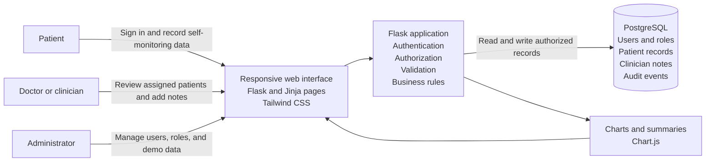
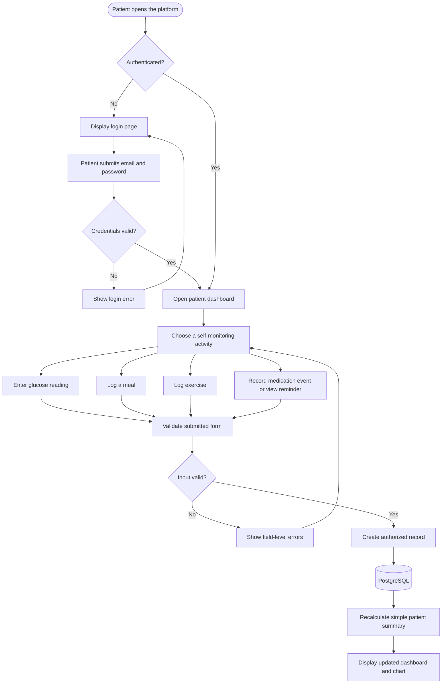
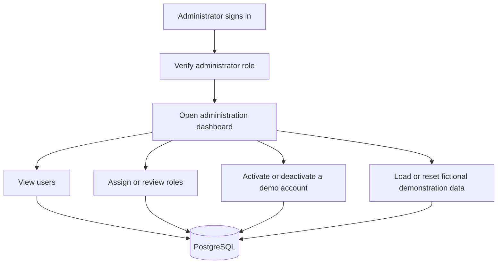
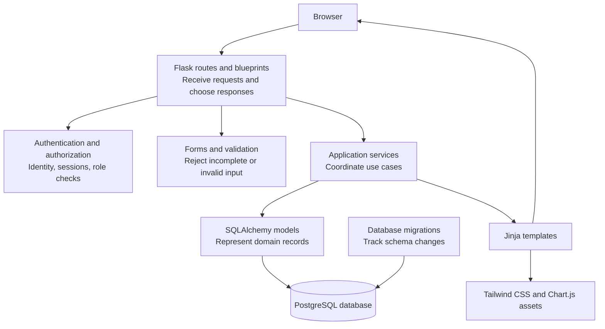
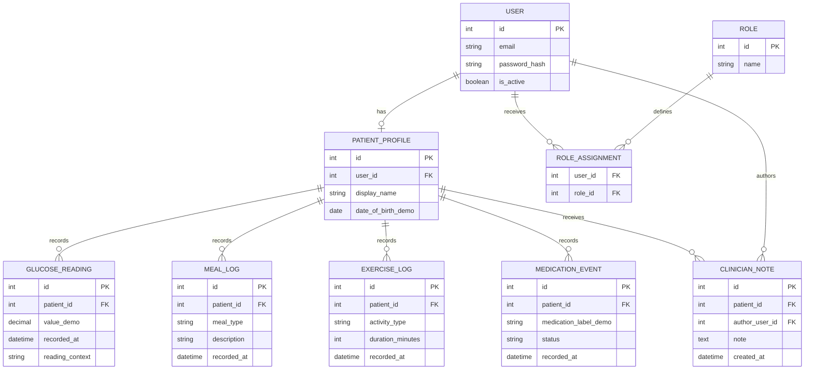

# System Tutorials and Flowcharts

## Purpose

# Use (CTRL + SHIFT + V) to convert to mermaid and view flowcharts.

This document explains how AfyaGlyco is expected to work before implementation begins. It is both a student tutorial and a living design reference.

The diagrams use Mermaid flowchart syntax. They should be readable in Markdown tools that support Mermaid, and they should be kept close to the written explanation so that a reader can follow the system from user action to stored data and back to the user.

The system shown here is theoretical. It is designed for an academic capstone demonstration using fictional or seeded records.

## How to read the model

- A user action starts a flow.
- A Flask route receives and validates the request.
- A service or model applies the application rules.
- PostgreSQL stores or retrieves the record.
- The response returns to the appropriate dashboard.
- A clinician note or simulated reminder is shown as application output, not as an autonomous medical decision.

## 1. System context

The platform has three human roles. All roles use the browser interface, but each role sees only the areas permitted by its authorization.

## 2. Patient data-flow tutorial

This is the primary student demonstration flow. It shows how a patient creates a record and later sees it in a dashboard.

## 3. Clinician review flow

The clinician does not receive every record as a separate task. The prototype presents patient history, trends, and clinician-authored notes for review.

```mermaid
flowchart LR
    Clinician[Clinician signs in]
    Auth[Flask authentication and role check]
    List[Assigned patient list]
    Select[Select a patient]
    Records[Retrieve authorized records]
    Trend[Build simple trend summary]
    Review[Clinician reviews entries]
    Note[Add feedback or follow-up note]
    Store[(PostgreSQL)]
    PatientView[Patient can see clinician feedback]

    Clinician --> Auth --> List --> Select --> Records
    Records --> Trend --> Review
    Records --> Review
    Review --> Note --> Store
    Store --> PatientView
```

The feedback is authored by the clinician. The system stores and displays it; it does not generate treatment instructions on the clinician's behalf.

## 4. Administrator flow

The administrator controls demonstration accounts and access. This flow is intentionally small so that the capstone can show role management without becoming a complete enterprise administration system.

## 5. Logical application interconnection

This diagram describes the expected separation of responsibilities in the Flask application. It is not a requirement to create every box as a separate Python package immediately; it is a guide for keeping responsibilities understandable.

## 6. Theoretical records and relationships

The initial data model should remain understandable for a student project.

The field names above are conceptual. They may change during implementation, but the ownership and authorization relationships should remain explicit.

## 7. Student demonstration tutorial

### Prepare the demonstration

1. Start the Flask application.
2. Connect the application to a local PostgreSQL database.
3. Run database migrations.
4. Load deterministic fictional seed data.
5. Open the application in a browser.

### Demonstrate the patient role

1. Sign in with the seeded patient account.
2. Open the patient dashboard.
3. Add one glucose reading, meal, exercise record, and medication event.
4. Return to the dashboard.
5. Show the new entries and updated chart.
6. Open the feedback area and show any existing clinician note.

### Demonstrate the clinician role

1. Sign out and sign in with the seeded clinician account.
2. Open the assigned patient list.
3. Select the demonstration patient.
4. Review the patient's entries and trend summary.
5. Add a clearly labelled follow-up note.
6. Sign back in as the patient and show the note.

### Demonstrate the administrator role

1. Sign in with the seeded administrator account.
2. View the user list.
3. Show role assignments.
4. Activate, deactivate, or update a fictional account.
5. Explain that administrator actions are restricted from the patient and clinician views.

## 8. Design-change checklist

Whenever a significant design change is made, update this document before considering the change complete.

A significant change includes:

- Adding or removing a user role
- Adding or removing a major module
- Changing the patient-to-clinician workflow
- Changing how records are created, stored, or displayed
- Changing an entity or relationship in the data model
- Adding a new external integration
- Changing authorization boundaries
- Changing a dashboard's main data flow

For each significant change:

1. Update the affected written explanation.
2. Update every affected Mermaid diagram.
3. Check that labels and arrows match the implemented behavior.
4. Add a short entry to the design-change log below.

## Design-change log

| Date | Change | Affected diagrams or sections | Reason |
| --- | --- | --- | --- |
| 2026-11-05 | Created the theoretical capstone system model | All sections | Establish the initial design baseline |

